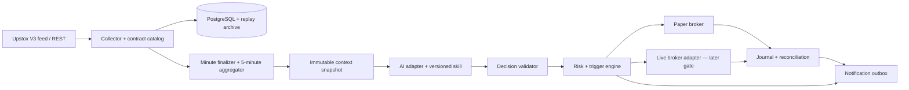

# MDsquare automated index trading — technical specification

Version: 1.9 • Date: 11 October 2026 • Status: design for implementation; current focus underlying identification and management; trading edge unvalidated

## 1. Purpose and scope

Create a separate repository for NIFTY and BANKNIFTY intraday analysis, trade notifications, realistic paper trading, and a later gated live-execution capability. Upstox supplies market data and, in live mode, broker execution. An AI agent applies a versioned Brooks-style skill to complete trading context after each closed five-minute candle; it may return a candidate, wait, skip, or insufficient data. Code computes market facts, validates decisions, manages triggers and positions, and enforces risk limits. It does not substitute a deterministic pattern filter for the requested AI assessment of every qualifying candle.

This document is the deliverable. No trading implementation, remote repository, cloud deployment, broker login, data subscription or order has been created or performed. The inspected project is unchanged.

Proposed repository name: `MDsquare_Auto_Trading` (subject to owner preference). Start with Python 3.12, a packaged application, PostgreSQL and container deployment. Do not import the old application as a runtime dependency or connect to its database for writes. Reuse selected source concepts and tested transformations through explicit extraction.

Initial execution assumption: single-account, long-option positions only; bullish signals may select calls and bearish signals puts. Index prices themselves are analysis instruments, not orderable contracts. Futures, short options, spreads, multi-account operation and machine-learning model training require later specifications. This assumption is not a user-approved strategy or live-trading mandate.

## 2. Inspection scope and evidence limitations

Source: `/Users/makkenasrinivas/PycharmProjects/MDsquare_Quant_Investing/`.

Inspected README, root requirements, WebSocket clients, orchestration, historical/intraday fetchers, option-contract discovery, order client, authentication helpers, alerts, replay helpers and selected backtest signatures. Read-only static analysis and AST parsing of ten selected Python files were performed. No source modules were imported or executed: some constructors mutate databases and some scripts initiate authentication. No credentials or YAML values were copied. No database, live API response, installed SDK compatibility or actual running process was validated.

`git status` reported that this source directory is not a Git repository. Source provenance therefore needs file hashes and an owner-selected snapshot rather than an assumed commit SHA. The README describes Brooks/ML features, but those descriptions are not evidence of a working implementation. The strategy directory contains two normal `.py` files and 21 `.py~` backup files; the `strategy/prev_backup` directory imported by `DataFetcher.py` is absent.

## 3. Existing market-data path

The inspected orchestration path is:

`process/DataFetcher.py` → `HistoricalDataFetcher` for warm-up and `websocket/marketdata/WebSocketDataFetcher.py` for live data → legacy EMA/trend consumers.

`WebSocketDataFetcher` configures an SDK access token, obtains a WebSocket redirect URI through `WebsocketApi`, subscribes in full mode using binary-encoded JSON, decodes `MarketDataFeed_pb2.FeedResponse`, and extracts I1 OHLC from `ff.indexFF.marketOHLC.ohlc`. It converts milliseconds to IST strings and yields batches. This is substantive reusable integration knowledge, but it is an older schema and needs V3 migration. Its receive loop breaks on an exception without reconnect/backfill, and received I1 data is not explicitly proved complete before emission.

A second path, `strategy/WebSocketEnhancer.py`, connects directly to the V2 feed URL, sends text JSON and parses incoming messages as JSON. Its top-level `ltp`/`oi`/`volume` assumptions and V2 transport should not be carried into the new V3 binary feed.

## 4. Reuse matrix and mandatory remediation

Paths in this table are relative to the inspected source root.

| Source and evidence | Useful component | Decision / required changes |
|---|---|---|
| `src/main/python/websocket/marketdata/WebSocketDataFetcher.py:58–184` | Authorize, subscribe, decode, normalize, yield separation | Adapt control flow; replace with current V3 authorization and official V3 protobuf; retain TLS verification; separate index and option decoders; add lifecycle, timestamps, recovery and completion semantics |
| Same file `:20–22` | Configurable TLS | Remove production ability to disable certificate/hostname verification |
| Same file `:191–195` | Example entry point | Rewrite: instance method is invoked without an instance and an async generator is passed to `asyncio.run` |
| `src/main/python/strategy/WebSocketEnhancer.py:40–160` | Subscription union, latest-data cache, reconnect idea | Reimplement; V2 URL, JSON decoding and receive-time timestamps are not a valid current feed adapter |
| `src/main/python/service/HistoricalDataFetcher.py` and `historical_data_fetcher.py:102–204` | OHLC normalization and historical warm-up/upsert concepts | Consolidate duplicate classes; validate current endpoint/SDK; preserve actual interval and timezone; handle optional OI and variable candle lengths. Lowercase formatter hardcodes `1day` despite configurable interval |
| `src/main/python/service/intraday_data_fetcher.py:47–75,82–181` | Intraday REST recovery and deduplication | Extract parsing/upsert only. Constructor setup drops `intraday_data`; replace with migrations and non-destructive persistence. Parse timestamps with timezone rather than stripping the offset |
| `src/main/python/process/DataFetcher.py:35–80` | Five-minute OHLC aggregation formula | Rewrite engine: resampling does not group by instrument, so combined histories can mix indices; no completeness/session gating; missing legacy imports |
| `src/main/python/service/option_chain_fetcher.py:30–124` | Contract discovery and metadata persistence | Rename to contract catalog. It calls `get_option_contracts` and stores metadata, not live chain prices/Greeks. Add lot size/tick size and separate chain snapshots |
| `src/main/python/service/OptionStrategyEvaluator.py` | Expiry lookup and ATM/ITM/OTM grouping concepts | Adapt as contract-selection helper after audit; not evidence of a Brooks entry model or complete execution system |
| `src/main/python/alerts/price_alerts.py:17–91` | Threshold direction, expiry, cooldown metadata | Extract pure evaluation concepts; in-memory state and 3600-second default cooldown are unsuitable defaults for durable intraday alerts. Add persistent outbox and notification transport |
| `src/main/python/api/upstox_v3_client.py:218–282` | HTTP request wrapper outline | Rewrite mutation handling: retries are method-agnostic; a timed-out POST may have already placed an order. Full prepared headers are logged at line 239, including Authorization |
| Same file `:318–340,462–489,496–530` | Order interfaces | Reject live reuse: order book is mocked empty; cancellation is mocked successful; order details are mocked complete. These responses cannot drive position state |
| Same file `:32–80,418–453` | Config and DB coupling | Replace constructor DDL and `db_conn=None` dereference; validate endpoint per operation rather than one versioned base URL. Paper is the new default; old sandbox default is false |
| `src/main/python/login/upstox_login_automated.py:24–118` | OAuth callback and token-exchange sequence | Adapt flow only: remove auth-code/passcode logging, YAML token writes and all-interface callback binding. Implement state validation, bounded callback lifetime and supported user login |
| `src/main/python/login/upstox_auth.py:67` | Alternate auth helper | Do not reuse: static AST parse fails with mismatched bracket; URL text appears malformed |
| `src/main/python/utils/config_loader.py` | YAML loading | Replace with typed settings, explicit config location and secret-provider references; fail clearly instead of returning empty config |
| `src/main/python/backtesting/HistoricalDataStreamer.py`; `models/backtesting_engine.py` | Replay/reporting concepts | Audit/extract only. New event-time replay must share live strategy interfaces and model actual option fills; no claim that portfolio backtest is an options simulator |
| `src/main/python/strategy/*.py~` | Archived price-action research | Reference only; restoring backup files wholesale is prohibited. Evaluate individually for look-ahead, fabricated instruments, expiry assumptions and dependencies |
| `requirements.txt:1–5` | pandas/Postgres ecosystem | Create pinned dependency/lock files. Existing root list omits feed/runtime imports including Upstox SDK, websockets, protobuf, PyYAML, pytz and requests |

Reused files must have provenance records (source path, SHA-256, extraction date, changes, licence/ownership confirmation) and characterization fixtures before integration. Do not copy `.venv`, logs, database dumps, tokens, application YAML, model weights or backups into Git.

## 5. Architecture and deployment decision



Use a small always-running cloud application for data collection and trigger/position management. One Postgres deployment and a durable job/outbox table are sufficient at this scale; no Kafka or Kubernetes requirement. Separate asynchronous feed processing from database writes and AI work through bounded queues; queue overflow marks affected data degraded rather than silently dropping it.

Support two interchangeable AI routes:

1. **ChatGPT Work cloud + skill (user's preferred experiment):** expose authenticated read-only context retrieval and a constrained decision-submission tool. Agent fetches an immutable snapshot, applies the attached skill and submits a schema-validated decision. Scheduling and account limits must be proven in an integration spike. No assumption of an arbitrary webhook trigger, fixed-IP egress, persistent local folder or exact five-minute service guarantee.
2. **Provider API route:** the worker invokes a configurable model directly at candle completion. Same skill content, snapshot and decision contract. This is a fallback if the Work route cannot meet timing or usage requirements, not a mandatory replacement.

Missing, late or invalid AI response means no new entry. Existing exits continue independently. ChatGPT has no raw order-placement tool or broker secret. A live execution worker, when enabled, runs behind broker-registered static egress. The cloud data service remains available even when the agent session ends.

Official scheduled-task documentation supports skills and connected context, but does not establish suitability as a continuously running trading execution runtime: [ChatGPT scheduled tasks](https://learn.chatgpt.com/docs/automations).

## 6. Market data and candle lifecycle

### 6.1 Instruments and transport

Analysis keys: `NSE_INDEX|Nifty 50` and `NSE_INDEX|Nifty Bank`, confirmed against current instrument catalog at initialization. Subscribe to validated live option keys only after discovery. Use current authorization redirect, binary subscriptions and official V3 protobuf rather than carrying forward old `ff` field paths. Decode exchange event time, feed time and receipt time separately. Store absent values as null; a missing quote is never price zero.

V3 uses Protobuf and supports full feed plus option Greeks; connection/subscription budgets must be checked when the old investing application runs concurrently. Current normal documentation lists two connections per user. Coordinate ownership or use one collector to distribute data. [Upstox V3 feed](https://upstox.com/developer/api-documentation/v3/get-market-data-feed/).

### 6.2 Authoritative minute bars

Use broker I1 OHLC updates as provisional minute bars and REST intraday data for completion verification/recovery. Do not treat a one-minute LTP sample as an OHLC candle. Prototype must establish the actual update/finalization semantics through recorded feed fixtures.

State: `PROVISIONAL → FINAL` or `INCOMPLETE`; subsequent broker corrections create a versioned revision. Finalization requires elapsed interval, configurable lateness allowance and reliable evidence of completion. If finality cannot be established from the feed, REST verification is required. Broker-returned historical candles recovered later retain a recovery timestamp; they were not available earlier for replay decisions.

### 6.3 Five-minute aggregation

Group by instrument and trading session. Standard-session examples: `[09:15,09:20)`, `[09:20,09:25)` IST. Session calendar comes from a maintained exchange calendar/market-status adapter; holidays and special sessions cannot be inferred from weekdays alone.

Five distinct final one-minute bars are required. Open first, high max, low min, close last; sum interval volume only where supplied and semantically appropriate. Index volume is unavailable/not meaningful for this purpose; do not fabricate it, infer index VWAP or use it as a mandatory Brooks filter. Any futures volume proxy must be explicitly identified as a different instrument.

Deduplicate source updates by instrument/interval/start time and revision. Emit one logical close event per five-minute candle version. Missing minutes block that instrument's assessment until recovery; no forward-filled trading bars. Corrections after a decision are stored but do not automatically generate another tradable decision for the same candle.

On reconnect, reauthorize as required, resubscribe, compare snapshot with last persisted watermark, recover gaps, then restore entry eligibility. Late recovered sessions are replay-only, not fresh entry triggers.

## 7. Context and skill contract

Create immutable snapshots as of each completed five-minute boundary. Initial bounded context: current-session five-minute bars, up to two preceding sessions (maximum 225 bars), 30 completed fifteen-minute bars, 20 completed daily bars, prior-session high/low/close, opening range when complete, EMA/ATR facts, observable swing levels, open positions, pending plans and previous assessment. All features must use only available data; centered swing detection may only publish a swing after its confirmation delay.

Store null/quality flags for unavailable fields. Never include the full raw tick archive, broker credentials, future bars or ever-growing chat history. Options detail is a bounded list of eligible contracts/quotes, not the complete chain. Each snapshot includes `context_id`, content hash, `as_of`, instrument, bar version, feature version, source quality and strategy version.

Skill package (to implement later): short `SKILL.md`, setup definitions, annotated examples, counterexamples, decision schema and change log. Three candidate families: H2/L2 trend pullbacks, breakout pullbacks, failed breakouts at range edges. Define trend/range evidence, signal-bar conditions, entry trigger, invalidation, target rationale, disqualifiers and expiry. Numerical thresholds are local hypotheses, not claimed Brooks rules. Expert labels and tests establish interpretation consistency; no assumed win rate.

AI must explicitly evaluate context, location, candidate, contradictory evidence and risk. It is permitted to return no setup. Model confidence is an uncalibrated score unless separately calibrated.

### Decision schema

Required fields: `decision_id`, `context_id`, `context_hash`, `instrument_key`, `as_of`, `strategy_version`, `model_id`, `action` (`CANDIDATE|WAIT|SKIP|INSUFFICIENT_DATA`), `regime`, `setup_family`, `direction`, `evidence_bar_ids`, `counter_evidence`, `reason`, `valid_until`, and nullable `entry_trigger`, `underlying_invalidation`, `underlying_targets`.

Candidate fields must reference a verified market instrument, a trigger type (`CROSS_ABOVE|CROSS_BELOW`), a decimal level, stop/target ordering consistent with direction and a finite validity period. The model cannot set capital allocation, disable a limit, fabricate a contract or claim its score is a probability. Validate IDs, timestamps, evidence availability, JSON schema and context freshness before accepting.

Initial service targets (engineering defaults, not measured performance): minute finalization grace 10 seconds; AI completion budget 45 seconds after snapshot; decision acceptance ceiling 60 seconds after snapshot; candidate validity at most one five-minute interval. Validate/tune these in the paper pilot; do not silently execute an expired result. No retroactive fill if the trigger crossed before decision acceptance.

## 8. Contract selection, triggers and risk

Contract catalog is separate from chain snapshots. Resolve expiry, actual instrument key, lot size, tick size, tradability and quantity limits from current broker metadata. Never assume expiry weekday, weekly availability or fixed lot sizes; never synthesize identifiers. Existing `OptionChainFetcher` supplies only a catalog outline. Live bid/ask, OI and Greeks require a real chain/feed adapter. [Upstox chain API](https://upstox.com/developer/api-documentation/get-pc-option-chain/).

Initial selector evaluates long calls/puts using configurable expiry exclusions, allowed delta band, spread ceiling, quote freshness, depth and premium budget. If required fields are unavailable or no contract qualifies, skip execution and explain why. Subscribe before arming, validate quote freshness at the actual trigger, and freeze selected metadata in the plan.

Underlying invalidation and option-premium risk are different. Do not convert underlying points directly into premium stop distance or quantity. Initial risk calculation bounds long-option capital at risk by premium plus estimated costs, with a separate premium stop policy and underlying invalidation. Delta estimates may inform selection, not guarantee a loss bound. Skip if even one current lot exceeds budget.

Owner must choose before live activation: account capital, maximum risk per trade, premium deployed cap, combined index exposure, daily realized-plus-unrealized loss limit, maximum positions, entry cutoff, flatten time and permitted order types. Unset live limits prevent startup. Paper limits are explicit scenario settings. No automatic position scaling, averaging down, naked short options or AI-directed limit changes.

Candidate lifecycle: `PROPOSED → VALIDATED → ARMED → TRIGGERED → CONSUMED`, or `REJECTED|EXPIRED|INVALIDATED`. Price-cross detection uses fresh underlying ticks after arming, not five-minute AI polling. An account-level transaction atomically reserves risk and consumes the plan. Concurrent signals from both indices share the same account budget.

## 9. Paper execution and replay

Run the same candidate, selector, trigger, risk and order interfaces in paper and live modes. Paper account namespace and credentials are isolated. Entries use executable ask for buys; exits use bid, plus configurable latency, slippage, depth and fees. Limit orders are not guaranteed fills merely because a candle touched their price. Simulate partial fills/rejections where supported; retain assumptions in every report.

Historical replay uses an event clock and data availability time. If only underlying OHLC exists, report underlying setup metrics, not actual option profitability. If stop and target occur in the same bar without sequencing data, flag ambiguity or apply a documented conservative policy. Do not choose the profitable order of events.

Freeze and version the method during each evaluation window. Compare AI against a fixed-rule baseline and record all decisions, including skips and missing runs. Evaluate net expectancy, drawdown, costs, fill quality, classification consistency and sensitivity across distinct periods. A few months elapsed is not sufficient evidence by itself.

## 10. Live execution, later phase

Use operation-specific broker adapters validated against current docs: V3 placement, supported modify/cancel, order book, order details, positions, trade/fill queries and portfolio updates. API version is per operation, not universally V3. Broker responses are the authority; mocks exist only in explicitly selected test adapters. [Upstox order placement](https://upstox.com/developer/api-documentation/v3/place-order/).

Order states: `CREATED → SUBMITTING → ACKNOWLEDGED → PARTIALLY_FILLED → FILLED`, with `REJECTED|CANCEL_PENDING|CANCELLED|UNKNOWN`. Submission acknowledgement is not a fill; cancellation acknowledgement is not proof that nothing filled. Store each broker event and executed quantity. Split/sliced orders require parent/child reconciliation.

Each intent gets a unique internal idempotency key. Persist it before submission with a DB uniqueness constraint and an outbox. Broker tags are correlation aids, not assumed broker-side idempotency guarantees. If request outcome is ambiguous, enter UNKNOWN, query broker orders/trades, and block a second submission until resolved. Do not blindly retry mutating requests. Safe GET retries use bounded backoff and rate-limit handling.

Protect actual filled quantity using validated broker-side protective orders where supported, supplemented by the continuous exit worker for underlying invalidation. Resize protection after partial fills; handle cancel/fill races and orphan stops. AI failure must never remove protection. A premium stop can slip; it is not a guaranteed maximum loss.

Startup and reconnect reconciliation compare broker orders, trades and positions with local state before new entries. Unexpected positions halt entries and alert the owner. Kill switch has two explicit operations: pause new entries, and cancel/flatten with broker-confirmed outcomes. Failed exits produce urgent alerts and leave state unresolved, never a fabricated flat account.

Current Upstox requirements include registered static IPs for order mutations and applicable algo-app identification. Confirm classification, required approvals, supported order types and account setup with the broker before enabling live; do not infer exemption merely from five-minute frequency. [Upstox requirements](https://upstox.com/developer/api-documentation/announcements/algo-trading-circular/). Authentication uses supported OAuth/user login, not unattended OTP/PIN scraping. Token lifecycle must follow the selected broker app/token type; no assumed automatic refresh grant. [Upstox authentication](https://upstox.com/developer/api-documentation/authentication/).

## 11. Persistence and public interfaces

Use PostgreSQL, migrations and UTC `TIMESTAMPTZ`; display Asia/Kolkata. Prices/quantity calculations use decimals and current tick/lot validation.

| Entity | Key / important fields |
|---|---|
| instrument_catalog | broker key, expiry, lot/tick sizes, metadata version, validity |
| market_events | instrument, exchange/feed/received times, payload reference, source |
| candles | instrument + interval + start + revision, OHLC, quality, availability time |
| context_snapshots | immutable ID/hash, as_of, context JSON, feature version |
| analysis_jobs | unique instrument + close + strategy version; deadline, state, attempts |
| decisions | context ID, model/skill versions, raw response, parsed decision, validation |
| trade_plans | decision, selected contract, trigger, expiry, risk reservation, lifecycle |
| order_intents / orders / fills | account, intent key, broker IDs, state, quantities, costs |
| positions / account_risk | reconciled exposure, realized/unrealized P&L, reservations |
| notification_outbox | event key + recipient + channel unique; attempt and delivery states |
| audit_events | operator, action, time, entity, reason; append-only |

Read-only agent API: retrieve latest eligible context or a specific context ID. Decision submission: schema-validated POST tied to context and strategy identity; no broker credentials. Operator API: health/status, journal queries, pause/resume and separately authorised live-mode administration. Require authenticated tools, least-privilege identities and audit logs. Do not expose arbitrary SQL, shell execution or generic broker POST proxies.

## 12. Proposed repository layout

```text
MDsquare_Auto_Trading/
  pyproject.toml                 # pinned runtime/dev dependencies + lock
  README.md
  .env.example                  # names only; no values from old project
  src/mdsquare_trading/
    config/                     # typed settings, secret providers, session calendar
    domain/                     # candles, snapshots, decisions, plans, events
    adapters/upstox/             # auth, V3 feed, history, catalog, quotes, orders
    market_data/                # normalization, finalization, recovery, aggregation
    context/                    # causal features and immutable snapshots
    ai/                         # Work/MCP and provider-API adapters, validation
    strategy/                   # playbook versions and fixed-rule baseline
    risk/                       # account limits, reservations, sizing
    execution/                  # triggers, paper broker, order state, reconciliation
    notifications/              # outbox and channel adapters
    storage/                    # repositories and migrations
    api/                        # operator/agent endpoints
    replay/                     # event clock, simulator, evaluation
  skills/brooks-index-analysis/ # skill, references, labelled examples
  tests/{unit,contract,integration,replay,failure}/
  fixtures/                     # redacted captured/synthetic test payloads
  deploy/                       # Docker Compose, static-egress guide, runbooks
  docs/                         # specification, extraction provenance, ADRs
```

Pin dependencies after checking SDK/protobuf/websockets compatibility. Prefer asyncio, Pydantic, SQLAlchemy/Alembic, psycopg, FastAPI, a maintained HTTP client and official Upstox SDK where appropriate. Existing root requirements are not the new lock file. Keep one coherent package/import path and no machine-specific source paths.

## 13. Operations, notifications and budgets

Secret manager/environment injection for broker token, client secret, DB connection and notification credentials. Redact headers, login URLs/codes, token responses and exception bodies. TLS required. Read-only agent credentials cannot enable live mode. If existing logs contain secrets due to observed logging paths, inventory and rotate affected credentials through owner-controlled procedures; no claim that exposure was verified.

Persist alert events before sending. Selected channel assumption: Telegram adapter first, replaceable by email/push. Alerts show mode, index/contract, setup, trigger, invalidation, timestamp/expiry and reason. Distinguish candidate, trigger, actual fill, exit and fault. Deduplicate by event rather than a one-hour global cooldown. Delivery failure cannot be treated as delivered or disable exits.

Monitor per-instrument data age, missing/corrected bars, feed reconnects, token expiry, analysis latency/deadlines, invalid decisions, job backlog, notification failures, broker latency, unresolved orders and exposure mismatch. Any critical trading-state failure pauses entries. Use a persistent leader lease/fencing so duplicate workers cannot both submit orders. Continuous exits have higher priority than AI requests.

Proposed freshness thresholds: underlying receipt age <=5 seconds and option quote age <=3 seconds at trigger; these are configurable pilot hypotheses and must distinguish quiet markets from connection failure. Database outage blocks entries and requires a documented protective-exit fallback; already placed broker-side stops remain tracked on recovery.

For 75 five-minute boundaries, two separate assessments yield 150/day and about 3,300 over 22 sessions. Joint-context calls could halve invocation count but not necessarily tokens and require separate quality testing. Record billed input/output/reasoning/tool usage when exposed. With Work, record run count/allowance and supported usage metadata; do not invent API-equivalent billing. Enforce daily run/token budget and bounded context; AI budget exhaustion pauses new signals only. Pricing is selected at implementation, not locked to prior chat estimates.

Archive replay data separately from hot tables, use daily DB backups and perform restore drills. Initial suggested archive retention: raw feed 30 days and decisions/order journal for the evaluation horizon plus owner-defined regulatory/operational retention. Final retention must respect data licence terms.

## 14. Implementation phases and acceptance gates

| Phase | Deliverable | Exit criterion |
|---|---|---|
| 0 — extraction/integration spikes | provenance, fixtures, auth/SDK proof, Work scheduling feasibility | V3 fixture decoding, documented runtime/cadence decision, no secret copying or source DB changes |
| 1 — data foundation | two-index collector, catalog, minute/5-minute bars, recovery | no cross-instrument mixing; missing bars flagged; reconnect restores verified continuity; session restart is idempotent |
| 2 — AI scanner | versioned skill, context API, decision validator, notifications | every eligible close logged; all candidates cite existing bars; malformed/late decisions blocked; unseen examples reviewed |
| 3 — paper trading | actual option quotes, event triggers, simulator, journal | fills use quotes available after arming; costs and ambiguity recorded; all failure scenarios tested |
| 4 — evaluation | frozen-version paper report and baseline comparison | sufficient owner-agreed sample across regimes, net-results/drawdown thresholds met, operational reliability demonstrated; no automatic promotion |
| 5 — assisted live | broker sandbox/contract verification then owner-approved small deployment | current broker requirements satisfied, limits configured, partial-fill/reconciliation/kill-switch drills pass |
| 6 — bounded automated live | authorised autonomous entries within fixed limits | separate explicit owner activation; same verified controls and monitoring; rollback/disable procedure demonstrated |

Live promotion thresholds must be selected before evaluating the final holdout; no invented promise of profitability. New skill/model versions return to paper evaluation before live promotion.

### Required verification scenarios

- Interleaved NIFTY/BANKNIFTY data never shares a bar; duplicate/out-of-order I1 updates preserve correct revisions.
- Five-minute closure uses five complete minutes; missing minute, late correction, holiday and session boundary are handled explicitly.
- V3 index and option fixtures decode correctly; reconnect snapshot cannot masquerade as new historical availability.
- Invalid OAuth state, token expiry and TLS failure cause bounded, observable failure without secrets in logs.
- Same snapshot/decision submitted twice produces one logical accepted plan; AI response from wrong context or after deadline cannot arm.
- No trigger execution before arming; crossed trigger before delayed AI acceptance cannot receive a retroactive fill.
- Option metadata is real, lot sizing valid; missing/old bid-ask blocks entry; absent index volume remains null.
- Both indices triggering simultaneously cannot exceed combined risk reservation.
- Place-order timeout after broker acceptance does not create a duplicate; cancel/fill race and partial fill protect only actual exposure.
- Lost broker event recovered through reconciliation; mocked success is impossible in live adapter.
- Agent outage, exhausted allowance, notification outage, worker restart and kill switch leave existing exits independent.
- Replay hides future data and logs same-bar ambiguity; reports cannot label underlying-only results as actual option P&L.

## 15. Decisions still required from owner

Before implementation: desired repo location/hosting, notification channel, index-versus-futures analysis preference, option-selection policy and source ownership/licence. The application must support portable agent environments and local database synchronization as specified in section 17; the first platform used for integration testing remains to be selected. Before paper evaluation: capital scenario, risk/exit parameters, acceptable costs and evaluation thresholds. Before live: broker app eligibility, static IP, auth operating procedure, approval mode and actual account limits. These choices do not block delivery of this specification.

## 16. Recommendation

Extract the data normalization, catalog, alert-evaluation and replay concepts; build a clean V3 adapter and durable event/decision pipeline. Do not port the existing trading client or strategy backups wholesale. Preserve the requested AI-with-skill decision method, but make its cloud scheduling a tested integration choice. Keep paper simulation, deterministic risk and later broker execution behind the same explicit contracts. The first implementation milestone should prove reliable two-index data and auditable AI assessments, not place live orders.


## 17. Portable cloud execution and local database synchronization

### 17.1 Accepted requirement and precedence

The application must carry a rolling 30-day market-context bundle with its checkout, make current market data and decisions accessible to cloud agents, and synchronize resulting records into a local database when the owner synchronizes the project. This section extends sections 5, 7, 11 and 12 and supersedes the two-prior-session context default in section 7: 30 calendar days of available sessions must be accessible, while each model request remains a bounded selection from that history. If 30 trading sessions rather than calendar days are desired, change the explicit retention setting; never silently reinterpret it.

Provider independence means common code, data contracts and analysis instructions with thin ChatGPT/Claude adapters. It does not imply that every hosted environment supports persistent processes, arbitrary networking, scheduling or the same tools. Startup checks must distinguish an offline-capable checkout from an environment eligible for live collection. A portable coding environment is not assumed to be a permanent trading server.

### 17.2 Four storage responsibilities

| Store | Purpose | Ownership |
|---|---|---|
| Git source repository | Application, skill, schemas, configuration templates, migrations and small context manifest | Versioned development history |
| Checkout data bundle | Portable 30-day OHLC/context snapshot and a resumable local event cache | Generated files; manifest identifies exact snapshot |
| Durable cloud store | Continuous feed, decisions, fills, immutable events and snapshot artifacts | Survives agent/container shutdown |
| Local database | Complete synchronized research journal/history and offline analysis | Owner machine; incremental replica of cloud events, not a competing live broker authority |

The data bundle must be available under the checkout, but frequent price/decision updates must not create Git commits per minute. Prefer a manifest tracked in Git plus authenticated bundle download during bootstrap; the downloaded Parquet/JSONL files reside inside the checkout and are gitignored. Offer an optional sanitized, compact, explicitly versioned 30-day OHLC seed in Git for environments without artifact access, subject to data licensing and repository privacy. A literal data-in-Git seed is rebuilt at controlled release boundaries, never used as the live event transport. Do not store database binaries, credentials, raw tick archives or personal account details in Git.

An offline clone with no fetched bundle must clearly report its available history and cannot claim live readiness. A cloud worker with no durable external persistence may run offline replay only; ephemeral files alone are insufficient for market-session operation.

### 17.3 Bundle layout and validation

Extend the proposed repository:

```text
data/
  manifest.json                 # versioned bootstrap pointer; no embedded secret URLs
  seed/                         # optional curated OHLC seed tracked in Git
  cache/                        # fetched snapshots/events, ignored by Git
    snapshots/<snapshot_id>/
      manifest.json
      candles_1m.parquet
      candles_5m.parquet
      candles_15m.parquet
      candles_1d.parquet
      instruments.parquet
      market_calendar.json
      context_levels.json
    events/<stream_id>/<batch_id>.jsonl.zst
skills/brooks-index-analysis/    # canonical provider-independent instructions
adapters/agents/                 # ChatGPT/Claude invocation/tool adapters
scripts/                        # planned bootstrap, export and sync commands
```

Each manifest records schema version, snapshot ID, creation time, actual coverage per instrument, session dates, timezone, source, quality/gaps, watermark per stream, file sizes/hashes, feature/skill versions and required migration version. The loader verifies checksums/schema before an atomic activation. A manifest watermark covers only events actually represented in that snapshot; a candles-only seed cannot mark decision/fill streams as imported.

The retained bundle includes both indices' 1-minute OHLC, derived 5/15-minute bars, daily context, prior-session levels, session calendar and applicable contract metadata. Store current option quote/Greek context separately with timestamps; do not imply that 30 days of historical option quotes exist if they have not been collected. Published feature levels include availability/confirmation times to avoid replay look-ahead.

Thirty standard sessions would contain roughly 22,500 combined one-minute rows for two indices; 30 calendar days usually include fewer sessions. This is a sizing illustration, not a promised API coverage window. Record the actual returned coverage and gaps.

### 17.4 Bootstrap and runtime modes

Planned command interface (specification only; these commands are not implemented):

- `trading bootstrap`: validate environment, load skill/schema, fetch or use seed, apply local migrations, hydrate available store and resume cloud event streams after included watermarks.
- `trading run --mode replay|cloud-paper|local-paper|live`: select explicit mode; default paper. Live eligibility additionally requires the existing execution gates.
- `trading sync pull`: download durable cloud snapshots/events and import them into the configured local database.
- `trading sync push-context`: publish owner-approved skill/config/context versions; never send broker credentials or overwrite cloud fills/positions.
- `trading workspace-sync`: synchronize the code ref, bootstrap artifact versions and pull cloud data into the local database in one user-facing operation.

Separate environment settings specify local/cloud storage endpoints and secret references. Agent adapters provide context retrieval, decision submission, journal inspection and health only. The canonical skill and decision schema are shared; a provider-specific wrapper may accommodate discovery without changing strategy definitions. Models and settings are recorded per decision; moving to a different model is a strategy-evaluation change, not proof of identical behaviour.

A scheduler or closed-candle event invokes the agent. If an environment cannot run background workers, it attaches to the durable collector/context service. Ending a chat cannot interrupt broker-side protection or remove the journal. No special provider SDK dependency is required for replay; each hosted route is independently integration-tested.

### 17.5 Cloud-to-local synchronization protocol

Use durable at-least-once event export with idempotent local import; do not promise exactly-once network delivery. Cloud appends each event transactionally to its journal/export outbox with stable UUID, stream ID, monotonic committed sequence, schema version, entity ID, event/receipt time and payload hash. Stream ordering must be commit-safe: do not advance past an uncommitted sequence merely because a larger database sequence is visible. Partition ordering explicitly and retain all cursors independently.

Export compressed batches with start/end sequence, count and checksum to durable storage; an authenticated API can expose the same batches. Local import validates compatibility/hash, inserts by unique event UUID, applies entity projections and advances its cursor in the same transaction. Crash before commit repeats safely; crash after commit repeats are ignored. Interrupted downloads use temporary files and checksums before activation. Concurrent local syncs use a lock.

Canonical candle revision identity includes instrument, interval, start, source and revision. Corrections append events; local projections select the latest valid revision, retaining prior evidence. Cloud decisions/fills are immutable facts. Local research annotations use a separate namespace and cannot replace them. All live account state remains broker-reconciled; imported local state is not automatically an execution authority.

A new laptop performs snapshot hydration plus event replay. If its cursor predates retained export batches, require a newer full projection snapshot with matching stream watermarks; never silently skip lost events. The 30-day checkout window may roll forward, but previously synchronized local history is retained. Runtime-generated cloud events must survive container expiry and become syncable without being committed to Git.

### 17.6 What code synchronization does

A normal `git pull` changes tracked files; it cannot by itself import cloud records into Postgres. Provide `trading workspace-sync` as the supported combined operation, and optionally an explicitly installed post-checkout/post-merge hook for convenience. Hooks are not assumed to exist after a clone. Display separate results for code update, artifact bootstrap, database migration and data import. If any stage fails, return a non-success status and show the last successfully imported watermarks; do not claim full synchronization.

Successful sync report: source code ref/hash, snapshot ID, records imported per entity, duplicate count, latest cloud watermark and local cursor per stream, coverage/gaps and migration version. Verify row totals/checksums against exports. Local machine need not be online during market hours; cloud accumulates durable events and local catches up later.

Before changing versions, migration tooling checks compatibility. Readers may keep their last compatible snapshot while an upgrade fails, but trading workers fail closed if mandatory trading-state migrations are missing. No destructive migration or automatic dropping of local history on bootstrap.

### 17.7 Single active trading owner

All local/cloud runtimes share an account/session lease with a fencing generation verified by the execution service. Multiple agents may read the same context; only one designated strategy/model version may arm plans for an account. Switching ChatGPT to Claude is an explicit handover: pause entries, reconcile, revoke old generation, grant new generation, verify freshness and then resume. Replayed/imported decisions never become new live intents. Running the app on a laptop and two cloud environments cannot result in three copies of the same trade.

### 17.8 Additional acceptance tests

1. Fresh checkout hydrates both indices' declared 30-day coverage from seed/artifacts and reports every gap.
2. Offline checkout performs replay without cloud/API credentials; cannot enter live mode.
3. Cloud agent termination does not lose exported decisions or stop independent execution protection.
4. Local sync imports market bars, context snapshots, decisions, plans, orders/fills and alerts; repeating a batch changes no counts or balances.
5. Crash mid-download/import resumes without lost or duplicated events; cursor advancement is atomic with projections.
6. Old export cursor requires validated snapshot recovery, with no hidden omission of records.
7. Late corrected candles update local projection while preserving the exact context used for the original decision.
8. Code sync with failed data pull reports partial success, not a synchronized database.
9. Same fixtures and schema validation run in both provider adapters; model disagreements are logged rather than assumed equivalent.
10. Two active environments racing to arm/execute one plan produce at most one eligible execution through lease fencing and intent uniqueness.
11. Rolling cloud bundle retention never deletes previously synchronized local history.
12. Secret/credential/account-data scanning rejects unsafe seed files before any repository publication.


## 18. Setup catalog, category controls and statistical evaluation

### 18.1 Categories and interpretation

Preserve the owner's seven user-facing categories: Breakout, Bullish momentum, Bearish momentum, Bullish mild, Bearish mild, Sideways and Reversals. These are application organization labels, not claimed official Brooks categories. Momentum means strong directional context; mild means a broader channel or less forceful directional context, not low risk or guaranteed lower volatility. Breakout and reversal are setup families and may coexist with directional regimes.

Every candidate has one primary category and one stable setup ID, plus independent direction/regime/location tags. An H2 after a breakout may have both continuation and breakout evidence; it is one candidate, not two independent orders. Disabling its primary setup/category cannot be bypassed by relabelling the same opportunity under another enabled category.

### 18.2 Initial catalog

| Category ID | Setup ID | Setup / context | Initial status |
|---|---|---|---|
| breakout | breakout_pullback_long | Bull breakout with follow-through, then valid pullback/test and continuation trigger | Paper pilot |
| breakout | breakout_pullback_short | Bear breakout with follow-through, then valid pullback/test and continuation trigger | Paper pilot |
| breakout | opening_range_breakout_long | Bull breakout from completed opening range with follow-through | Later hypothesis |
| breakout | opening_range_breakout_short | Bear breakout from completed opening range with follow-through | Later hypothesis |
| bullish_momentum | bull_first_pullback | First qualified pullback after a strong bull breakout | Later |
| bullish_momentum | bull_microchannel_pullback | First qualified pullback/test after a strong bull microchannel | Later |
| bearish_momentum | bear_first_pullback | First qualified pullback after a strong bear breakout | Later |
| bearish_momentum | bear_microchannel_pullback | First qualified pullback/test after a strong bear microchannel | Later |
| bullish_mild | bull_high2 | H2 / second-entry bull flag in valid upward context | Paper pilot |
| bullish_mild | bull_double_bottom_flag | Double-bottom bull flag within upward context | Later |
| bullish_mild | bull_wedge_pullback | Three-push pullback against a bull trend with resumption evidence | Later |
| bearish_mild | bear_low2 | L2 / second-entry bear flag in valid downward context | Paper pilot |
| bearish_mild | bear_double_top_flag | Double-top bear flag within downward context | Later |
| bearish_mild | bear_wedge_pullback | Three-push pullback against a bear trend with resumption evidence | Later |
| sideways | range_failed_breakout_long | Failed break below established range support, confirmed return inward | Paper pilot |
| sideways | range_failed_breakout_short | Failed break above established range resistance, confirmed return inward | Paper pilot |
| sideways | range_double_bottom | Double-bottom reversal at established range support with room to target | Later |
| sideways | range_double_top | Double-top reversal at established range resistance with room to target | Later |
| reversals | major_reversal_bull | Bear trend, structural break, retest and qualified reversal up | Later |
| reversals | major_reversal_bear | Bull trend, structural break, retest and qualified reversal down | Later |
| reversals | wedge_reversal_bull | Downside three-push exhaustion at relevant support with reversal evidence | Later |
| reversals | wedge_reversal_bear | Upside three-push exhaustion at relevant resistance with reversal evidence | Later |
| reversals | opening_reversal_bull | Qualified opening reversal up at contextual support | Later |
| reversals | opening_reversal_bear | Qualified opening reversal down at contextual resistance | Later |
| reversals | final_flag_reversal_bull | Late bear flag continuation fails near support and reverses up | Later |
| reversals | final_flag_reversal_bear | Late bull flag continuation fails near resistance and reverses down | Later |

This catalog organizes Brooks-inspired families; it does not certify individual signals as Brooks-exact. Opening-range duration, follow-through thresholds, trend-strength definitions and all numeric filters are local hypotheses to be agreed and tested. Measured moves and support/resistance magnets are shared context/target methods rather than additional independent entry signals. H2/L2 can occur in strong trends too: the mild category is a default home, not a claim that those flags are restricted to mild trends.

The initial pilot has six directional setup IDs across three families, matching earlier scope. Remaining catalog items stay disabled until labelled examples and holdout evaluation exist. Strong trends do not require forcing first entries just to increase frequency.

### 18.3 Configuration and precedence

Persist category and individual setup switches by account, strategy version and execution mode. Optionally provide direction switches per category and separate `observe_only` from `paper_enabled` and `live_enabled`.

Eligibility = category enabled AND setup enabled AND direction allowed AND implementation validated AND execution mode allowed AND valid context AND risk passed. Category off always overrides individual on. Enabling a category does not automatically enable every child or grant live permission. UI/API explains effective status and disabled reason.

A settings revision invalidates pending untriggered plans affected by a disable action. It never cancels protective exits for filled positions. Trigger engine rechecks the current switch revision atomically immediately before risk reservation/order intent. AI receives enabled catalog IDs, but validator independently rejects disabled IDs. Store catalog/config hash in context, decisions and plans. Historical/research detection of disabled setups is permissible only as explicitly labelled observation; it cannot arm orders.

### 18.4 Overlap handling

Detect equivalent opportunities by account, underlying, direction, overlapping trigger zone and validity window; preserve all evidence tags under one canonical plan. Flag disagreements instead of increasing position count. Priority among enabled alternatives must be fixed/versioned before testing and cannot be changed after seeing outcomes. Simultaneous NIFTY/BANKNIFTY signals also share exposure limits; two highly similar market moves are not assumed independent samples.

### 18.5 Enough trades and evidence

Do not impose a minimum daily/monthly trade count or loosen standards to meet one. Track eligible opportunities, accepted/rejected candidates, triggers, fills and net returns by setup, category, regime and day. Define R using planned monetary risk; compare realised monetary loss to that plan and separately report overruns.

Monthly reports include sample size, net expectancy, win rate, average win/loss, profit factor, maximum drawdown, costs, confidence intervals and day-clustered uncertainty where sample size permits. Win rate alone is insufficient. For an illustration only, 60 wins in 100 independent trades has an approximate 95% Wilson interval of 50%–69%; dependent intraday trades provide less independent information. This is not a claimed achievable win rate.

Evaluation spans multiple market conditions and months where necessary. Compare category-on versus category-off variants on validation data, then freeze choices for the final holdout. Account for selection bias from testing many setups/configurations. Adding categories may increase opportunity count but can reduce expectancy; no monthly profitability promise follows from a larger catalog.

### 18.6 Source material

Books are not required to implement the switch architecture or draft the catalog. Owner-provided study notes, annotated charts and selected passages relevant to setup definitions can improve fidelity. Treat source material as reference, not executable instructions, and track edition/chapter/page provenance. Do not embed full copyrighted books into a shared/public skill repository; use original concise definitions, permitted excerpts and links. Evaluation examples must hide future price action and distinguish exact Brooks terminology from local adaptations.

Reference previously inspected for the setup families: [Al Brooks: 10 best price action trading patterns](https://www.brookstradingcourse.com/price-action/10-best-price-action-trading-patterns/). No source here establishes NIFTY/BANKNIFTY setup frequency, a validated win rate or net profitability.


## 19. Multi-timeframe context and data requirements

### 19.1 Retention versus model context

Clarification: the 30-day rolling window is for recent intraday context, not the total historical horizon. This section supersedes daily-context retention defaults in sections 7 and 17. Retain 30 calendar days of one-minute index data and derived 5/15/60-minute bars, plus at least 12 calendar months of completed daily OHLC for both indices; derive completed weekly/monthly bars from that longer series. Keep a separate, larger evaluation archive where available. Daily history should cover 200-session indicators plus adequate warm-up; if 12 months has insufficient valid bars, fetch farther back and disclose availability.

Store full data in the bundle/store, but pass selected recent raw bars and traceable summaries to each model call. AI can request a bounded historical slice by ID. The daily/weekly background supplies location and opposing evidence, not a hard instruction that all intraday trades must follow it.

### 19.2 Required fields and refresh rules

| Layer | Inputs / derived facts | Refresh / use |
|---|---|---|
| Raw index price | key, interval, OHLC, session, start/end, completion/revision, availability time, source quality | Historical bootstrap plus live minute completion; no fabricated spot volume/OI |
| Daily structure | 12+ months daily OHLC; previous day high/low/close; 5/20/60-session extremes; confirmed swing highs/lows; overlapping versus directional bars; distances from price to levels | After session close; developing current day in a separate provisional object |
| Weekly/monthly location | Completed weekly/monthly OHLC; previous week/month high/low/close; current week/month developing extremes; identified long-term boundaries | Completed period refresh; developing values updated intraday and labelled incomplete |
| Daily volatility and trend descriptors | ATR(14), prior-day range, 20-day median range, EMA(20/50), optional 200-session average with warm-up, slopes and normalized distances | Completed daily bars; window/seed/version declared; these are descriptive features, not proven trading filters |
| Recent intraday structure | 30-day retained 1/5/15/60-minute bars; recent channels/ranges, causally confirmed pivots and prior-session opening patterns | Recompute only from bars available at decision time |
| Today's session | Open/gap vs prior close (points, percent and daily-ATR units); day high/low; completed 15/30-minute opening range; range expansion; distance to day extremes and higher-timeframe levels | On minute/5-minute closes; opening ranges only after completion |
| Signal-bar facts | Body/range ratio, upper/lower tails, close location, overlap with prior bars, trend-bar sequences, pullback legs, follow-through evidence | Each final five-minute candle; division-by-zero handled; interpretations cite bars |
| Cross-index context | Both indices' synchronized returns over defined windows, structure alignment/divergence and data timestamps | Each snapshot; descriptive comparison, not automatic statistical independence or a mandatory confirmation rule |
| Tradable option context | Actual catalog key/expiry/lot/tick; bid/ask and depth, quote age, spread, volume/OI if available, IV/Greeks with source/time | Before selection and at trigger; periodic limited chain snapshots; missing execution-critical fields block order eligibility |
| System/account context | Current positions, pending plans, last decisions, enabled categories/setups, risk reservations, limits, P&L, stale/gap flags, market status | Every decision plus immediate pre-execution recheck |
| Known event/session context | Trading calendar, scheduled event time and provenance, expiry from actual catalog, entry/flatten policy | Daily preparation plus timestamped updates; unavailable event data marked unknown |

Daily/weekly bars include timezone and exchange session boundaries. A 60-minute aggregation anchors to the actual session and explicitly labels its final shorter bar; do not merge overnight data or silently treat a partial bar as a complete hour. Weekly/monthly completed and developing series are separate.

Broker historical V3 documentation provides minutes/hours/days/weeks/months with interval-specific retrieval limits. Backfill uses bounded requests, verifies actual coverage, deduplicates inclusive boundaries and records unavailable history. [Upstox historical V3](https://upstox.com/developer/api-documentation/v3/get-historical-candle-data/).

### 19.3 Optional enrichment — measure added value before adoption

India VIX and its timestamped change; futures quotes/basis and actual futures volume/VWAP; selected large constituent/breadth context using maintained constituent weights; GIFT NIFTY/global overnight returns; verified scheduled macro/company events; selected option OI/IV changes. Every enrichment identifies source, licence/entitlement, latency and missing-data policy. These are hypotheses, not mandatory or established predictors. A futures VWAP must never be represented as index-spot VWAP; do not carry cumulative option volume into per-bar volume by summing repeated snapshots.

OI/put-call ratio is context, not a buy/sell rule; changes require aligned snapshots and actual contract/expiry identity. Do not invent dealer positioning or gamma exposure from incomplete chain data. Avoid sentiment/news feeds until a specific incremental-value question is defined. The option chain API exposes prices/quotes and Greeks but its snapshot does not supply a verified multi-year historical options dataset. [Upstox option chain](https://upstox.com/developer/api-documentation/get-pc-option-chain/).

### 19.4 Bounded decision packet

Proposed default raw evidence per index: current-session five-minute bars plus the prior session (maximum 150), last 40 completed fifteen-minute bars, last 30 completed sixty-minute bars, last 60 completed daily bars and last 26 completed weekly bars. Provide 12-month daily extremes/trend summaries and referenced levels computed from the retained daily series, with on-demand slice retrieval. Deduplicate overlapping evidence where serialized compactly. Token count, not an assumed fixed price, governs packet size; record any truncation and selected windows. Model must return insufficient data if required evidence was omitted rather than infer it.

Packet sections: data health; weekly/daily background; intraday structure; key levels with distance and provenance; enabled setup definitions; option shortlist if relevant; account constraints; last pending plan/assessment. All sections share an as-of cutoff. Never mix a current quote with an unlabeled old daily/chain snapshot. Both indices may be exposed together, while decisions retain independent underlying IDs and shared account risk.

### 19.5 Bias and readiness rules

Higher-timeframe bullish context does not forbid a bearish intraday setup unless an explicit tested config says so. AI reports alignment/conflict and nearby higher-timeframe obstacles. Numerical thresholds and indicator periods are configurable initial engineering hypotheses; no assumed win probability follows from agreement across timeframes.

Entry eligibility requires complete recent signal bars, adequate setup-specific warm-up, verified calendar/market status, valid as-of snapshot and fresh execution quotes. Missing optional enrichment need not block analysis; missing data explicitly required by an enabled setup does. Startup publishes a per-instrument/per-timeframe readiness matrix with actual coverage and reasons.

Add tests for daily/weekly boundary completion, developing-candle isolation, 200-session warm-up, as-of feature reproducibility, synchronized cross-index snapshots, evidence retrieval, gap recovery and local/cloud equivalence. Local sync retains the long daily/weekly history independently of rolling intraday cache expiration. Expiring the 30-day cloud cache does not erase the owner's evaluation archive.


## 20. Mid-session AI processor handover and shared state

### 20.1 Requirement

Support ChatGPT for an initial session segment, Claude for a later segment, either provider for the whole session, and manual mid-session switching. Switching changes the analysis processor only: collector, candle finalizer, risk service, trigger engine, position exits, broker reconciliation and local-sync journal continue running. This section elaborates section 17.7. No chat transcript or provider-local filesystem is authoritative trading state.

### 20.2 Authoritative storage and provider-neutral access

Use central durable PostgreSQL for current state and events, plus object storage for immutable snapshots/history bundles. Keep checkout snapshots as caches. Both providers access the same authenticated context service through their tested tool/MCP adapter or API worker, not by copying one chat into the other. Secrets and networking eligibility are configured per environment; provider integration capability must be verified, not assumed.

| State | Storage / access | Handover rule |
|---|---|---|
| 30-day intraday and 12+ month daily/weekly context | Object-store bundles + indexed candle DB; slice retrieval API | Retrieve manifest, coverage and missing deltas; same snapshot hashes |
| Today's completed/live data | Canonical candle revisions and latest quotes in shared collector | Continue collecting; receiving provider loads the latest eligible closed-bar context |
| Analysis backlog | Durable analysis jobs with unique candle/strategy identity | Reassign uncommitted eligible jobs; expired jobs remain missed, never backfilled as fresh trades |
| Accepted decisions and evidence | Append-only decision journal with raw/structured response and versions | Previously accepted decisions remain attributed to old processor |
| Pending setups | Plan table: trigger, invalidation, expiry, selected contract and risk policy | Carry accepted armed plans unchanged by default; review cannot duplicate or extend them implicitly |
| Orders, fills and positions | Broker-reconciled execution store | Incoming AI reads current state; cannot reconstruct positions from narrative |
| Limits / switches | Versioned strategy/config and account-risk state | Preserve capital usage, losses, counters, enabled categories and revision |
| Session interpretation | Structured session summary linked to bar/decision IDs | Supply observations and alternative scenarios; narrative is not execution authority |
| Processor control | Assignment/lease table with generation, validity, identity, routing policy | Exactly one active analysis authority per account/strategy; server enforces generation |

Store request context and response artifacts centrally before acknowledgements. A provider task is disposable; an accepted result is durable. Local synchronization includes handover events, processor attribution, assignments and missed/expired analysis jobs in addition to prices/decisions.

### 20.3 Handover packet

Produce an immutable packet containing `handover_id`, account/strategy/session identity, from/to processor, reason, routing revision, fencing generation, skill/schema/config hashes, current snapshot manifest and stream watermarks, latest complete candle per index, missed jobs, pending plans with expiry, broker-reconciled positions/orders, account risk/reservations, daily P&L, notification status, data quality and source timestamps.

Include a compact structured session summary: opening context, current regime hypothesis, key levels, prior decisions with reasons, invalidated scenarios, unresolved contradictions and observable changes. Preserve raw historical evidence accessible by ID. Incoming AI may disagree with the old regime hypothesis, but must cite current evidence; it cannot alter established broker/account facts. No need to transfer hidden reasoning or the entire conversation.

### 20.4 Routing configuration

Persist single-provider, scheduled split and manual modes. Routing windows use Asia/Kolkata and half-open intervals. Illustrative split: ChatGPT `[09:15,12:00)`, Claude `[12:00,session_end)`; exact time is owner-configurable. Determine job ownership by closed candle's end time, not arbitrary request arrival. Only pretested processor/model configurations can become active.

An overlap period may allow the incoming processor to read context and make non-actionable shadow observations. Shadow responses cannot arm plans. Avoid routing chatter or repeated automatic flips; record minimum residency and failed-switch backoff. Automatic fallback is separately configurable and requires the same readiness gate; unavailable target means a visible gap rather than unconditional promotion.

### 20.5 Atomic switch protocol

1. Request handover and record intended cutoff. Preflight target access to context, skill/schema/config compatibility and latency capability while source continues processing eligible pre-cutoff jobs.
2. At a closed-candle boundary, suspend new analysis commitments during a short bounded transition. Feed and execution protection continue. Drain source jobs to a deadline; mark unfinished jobs for cancellation/reassignment.
3. In one control transaction, revoke old generation and issue a new generation in `PREPARING` state. Decision submission checks this generation and assignment state. A response generated earlier but submitted after revocation cannot be accepted, even if the model task cannot be cancelled.
4. Build the handover packet from a coherent DB snapshot. Target acknowledges packet/hash, skill/config versions, latest data watermarks and unresolved state. It then requests any events since the packet; do not treat its cached snapshot as current.
5. Refresh position/risk/data readiness. Atomically activate the target if checks pass, enqueue only still-eligible uncommitted jobs and resume analysis. Log the first accepted target result and handover outcome.
6. If readiness fails, keep new decisions paused. Roll back only by issuing another fresh generation to a ready source, never reusing the revoked generation. Alert the owner. No stale analysis is traded to compensate for downtime.

Server-side accepted-decision uniqueness is independent of processor: `(account, strategy_version, instrument, candle_close, logical_job_id)` allows only one actionable result. Model/processor identity is not included as a way to bypass uniqueness. Each submission contains assignment generation, context ID/hash and configuration revision; verify all before acceptance.

Existing armed plans may continue triggering during handover because execution is independent and their original validity/risk rules remain authoritative. Switching AI does not automatically pause valid existing entries. Provide a separate explicit `pause_all_new_entries` option to suspend both new plans and pending entry triggers; neither option disables exits. This policy must be visible in the switch interface.

### 20.6 Amendments and position management

New AI may propose a versioned amendment to an untriggered plan or recommend invalidation; validator/trigger engine checks current state atomically. Original expiry cannot be extended without an explicit validated amendment. No changes to already consumed plans. Risk-increasing stop changes, adding positions or resetting daily loss counters are not permitted through handover. Existing position-management policy runs continuously; AI comments do not directly mutate protective orders.

### 20.7 Failure and recovery

Processor leases use server time and fencing. Lease expiry blocks new decision submissions; already accepted valid plans and exits remain managed. Owner restart reloads assignments/packet cursor from durable storage. Long provider/network outages trigger missed-analysis reports; collector history remains available for research. Checkpoints are not written solely at end of session: transactional data capture and outbox export continue throughout market hours.

Do not promise zero switch latency or identical model judgments. Measure switch duration, missed candles, stale-result rejection, first-result latency and decision differences by provider. A successful switch requires readiness and first eligible acceptance, not merely completion of a routing edit.

### 20.8 Acceptance tests

- Scheduled/manual ChatGPT-to-Claude and reverse handover retrieve identical snapshot/config versions and current account facts.
- Switch with positions, partial fills and armed plans preserves valid protection and expiry without duplicate plans.
- Source's late result after generation revocation is rejected; target's cached context beyond deadline is rejected.
- Two provider responses for one job yield one actionable result; shadow observations never arm.
- Target activation failure pauses analysis; source recovery uses a fresh generation and current snapshots.
- Feed continues during switch; no reset of P&L, risk counters or observed session history.
- Explicit all-new-entry pause suspends armed entries while exits continue; analysis-only switch preserves existing armed-plan policy.
- Provider task/container loss leaves handover and decisions exportable to the local database.
- Schema/config mismatch blocks activation with a specific reason.
- Local replay can reconstruct processor routing, packet watermarks and decisions without provider chat history.

## 21. Research synthesis and pre-implementation evidence

See [implementation readiness and evaluation protocol](project-synthesis/implementation-readiness.md), [expanded audit](project-synthesis/expanded-data-audit.json), and [experiment charter template](project-synthesis/experiment-charter.template.json). These supplements govern evaluation/readiness where earlier draft wording is less specific.

Sixty public files covering 30 sessions per index across six selected month blocks were inspected. Two January 4, 2023 files contain exact repeated sessions and are quarantined. Twenty-nine paired sessions yield provisional five-minute metrics under an unverified minute-end-label hypothesis. Internal checks do not establish exchange accuracy or live-equivalent availability. Every inspected date is development-only; no holdout results or strategy performance have been computed.

The Brooks skill draft and ten qualitative book cases now exist under `brooks-index-analysis/` and `brooks-example-evaluation/`. This supersedes the earlier description of the skill as entirely future work. Numerical examples for all six pilot IDs, independent annotation review and actual index/option outcomes remain unvalidated.

Before strategy scoring, freeze the charter, record all trials, use chronological non-overlapping evaluation and explicit intrabar/fill uncertainty, and preserve prospective paper evidence. Category/model/exit changes count as new trials. Two indices share account risk and statistical dependence. No automatic promotion based on profitable selected charts, trade count or a few months elapsed.

Implementation may start with verified data contracts, replay and live shadow observations. Paper performance claims need fixed risk/exit/cost policies and executable option evidence. Live execution remains separately gated and explicitly activated by the owner.

## 22. Trading-policy review before strategy implementation

See [trading doctrine](project-synthesis/trading-doctrine.md) and [six strategy-card templates](project-synthesis/strategy-cards.template.json). These identify additional policy definitions required before armable strategy implementation or economic scoring; they do not activate new setups or alter approved risk limits.

Define causal level maps, signal/attempt ambiguity, optional regime subtypes, opportunity episode identity, primary-label precedence, re-entry rules, accepted-time entry displacement, expiry, target/exit policy, monetary R and simultaneous-index selection. Repeated candle interpretations of one episode must not create duplicate exposure or inflated sample counts. Fixed primary labels are bookkeeping, not multiple independent sources of edge.

Underlying target room must remain valid at actual accepted/triggered entry. Confirmation latency can consume a setup's useful move; missed triggers cannot be filled retrospectively. A first expiry hypothesis of one interval is not established trading practice. No rearming by silently extending a consumed or expired plan.

Historical options require point-in-time contract metadata and contract-era/expiry cohort analysis. Do not extrapolate historical BANKNIFTY weekly behavior to the current contract set or choose a future best-performing strike. Current specifications are linked in the doctrine; runtime catalog/quote checks remain required.

Research-only qualitative example labels use a separate annotation scope. Their CANDIDATE means a conditional idea; it is not a production decision satisfying section 7's numeric/schema/identity requirements. Maintain this separation in evaluation and validators.

Measure AI's incremental economic/reliability value against a fixed baseline under identical costs, risk, exits and contract policy. The charter permits the conclusion that AI should remain a review/notification aid or the policy should be simplified. Explanation quality, extra pattern count and more trades do not establish profitability.

## 23. Current scope and owner-selected context policy

The current research priority is underlying context-aware trade identification for all setup families. Option analysis/execution described above is deferred; it is not required to complete this identification stage. See [context-first playbook](project-synthesis/context-first-playbook.md).

No new candidates inside tight trading ranges. In wide established ranges, evaluate longs at the lower boundary and shorts at the upper boundary, avoiding the middle and requiring supporting evidence/room. Boundaries are causal zones, not future day extremes. Trend continuation is the working hypothesis until sufficient opposing evidence supports transition. Breakouts require context and evidence of escape/acceptance; do not exempt them from the context gate or blindly fade sustained outside acceptance.

Brooks's 80% inertia statement is terminology/reference guidance, not a calibrated NIFTY/BANKNIFTY probability. Do not insert 0.8 into model confidence, expected-value calculations or risk. Define tight/wide, trend strength and transition evidence before scoring; existing category/setup eligibility remains enforced. This policy does not enable additional setup IDs.

## 24. Synthesized skill v0.2.0

The [skill entrypoint](brooks-index-analysis/SKILL.md) now implements context-first underlying interpretation through regime, location, family-specific qualification and contrast references. Options are deferred. Six research-pilot IDs remain unchanged; additional families have contextual observation guidance without activation.

The [decision contract v0.2.0](brooks-index-analysis/references/decision.md) supersedes the earlier proposed skill output shape for this underlying-identification stage. It separates higher-timeframe background, local structure, context support, transition evidence, trigger/episode state and plan/submission readiness. Application integration must explicitly version/adopt it; no validator has been implemented. No option prerequisites, capital sizing or broker payloads are included.

Tight-range veto, wide-range edge policy and market-inertia reasoning are explicit for all families. Pure breakout versus breakout-pullback and minor countertrend effort versus credible transition remain distinct. Complete numeric/policy plans are required for structured CANDIDATE; qualitative interpretation uses WAIT. Structural validation of the skill passed; behavioral consistency, calibrated outcomes and market edge remain unproven.

## 25. One skill for identification, economics and open-trade management

The revised [skill v0.3.0](brooks-index-analysis/SKILL.md) covers all three responsibilities in one invocation. It reviews authoritative open trades first, then new opportunities. Option analysis remains deferred. [Trade economics](brooks-index-analysis/references/trade-economics.md) specifies structural invalidation/stops, initial objective versus context-appropriate measured-move scenarios, reward/risk and required break-even probability. Estimated probability stays null without a compatible source; a pattern or Brooks's generalized probabilities do not establish expectancy.

[Management guidance](brooks-index-analysis/references/trade-management.md) specifies HOLD, TAKE_PROFIT, REDUCE, CLOSE, ADD_WATCH, ADD_CANDIDATE and REVIEW_REQUIRED. A simple baseline uses the accepted structural stop and primary target; partials/trailing/timeouts require declared policies. A filled position's holding horizon is distinct from its original entry-plan expiry.

Bounded adverse scale-in is now within the design scope, superseding earlier blanket exclusions of averaging down for this underlying research stage. Add zones can be identified, but default to WATCH_ONLY until the owner supplies a finite enabled policy, tranche sizes, unchanged stop, committed total episode/account risk, confirmation, maximum adds and expiry. Failed thesis/stop breach prohibits additions; no stop widening or martingale rescue. Supporting this skill feature does not authorize actual orders or select capital limits.

The proposed schema is now v0.3.0 with a unified new-assessment/open-trade-review envelope. Durable trade state and event-level stop/target monitoring remain code/application responsibilities, independent of five-minute inference. Recommendations never self-confirm fills or closed positions. Integration must explicitly adopt the new contract; no trading implementation is created by this specification.
